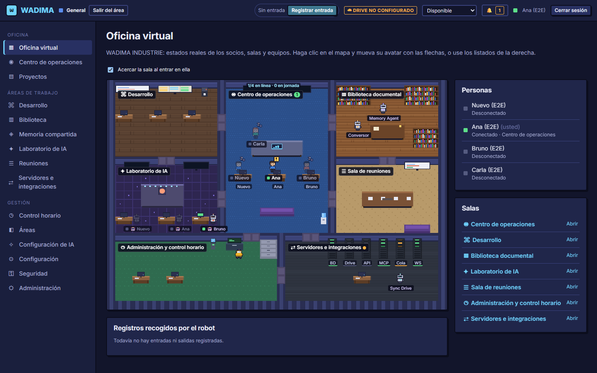
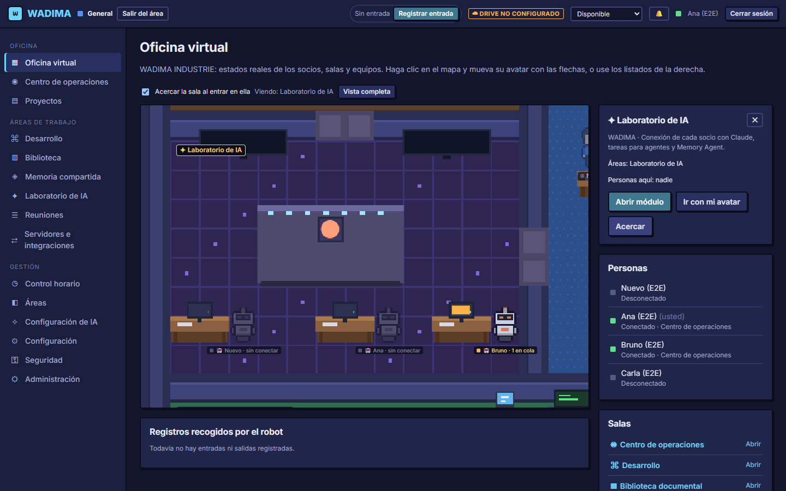
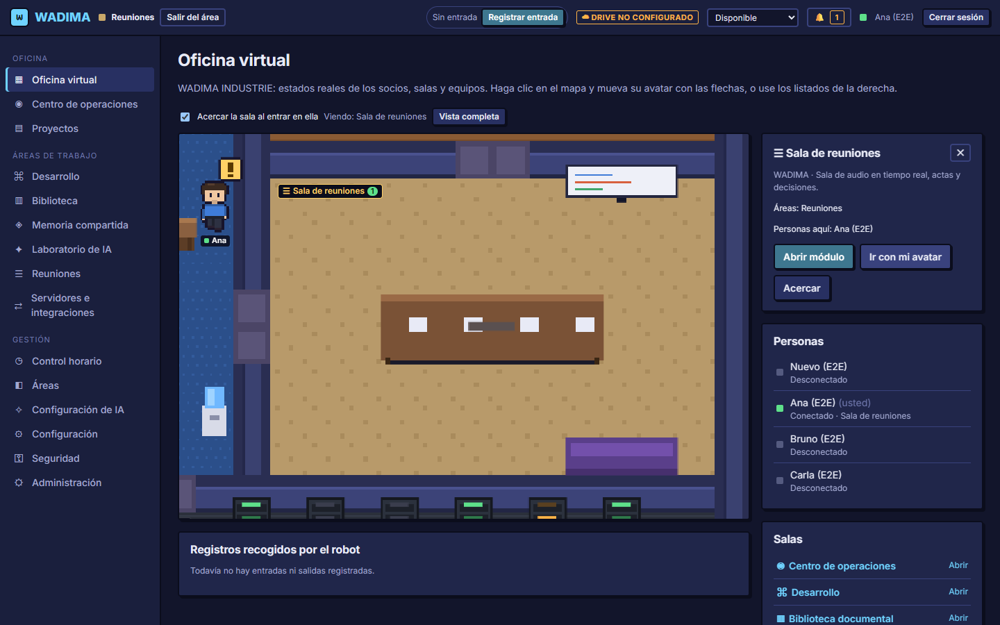
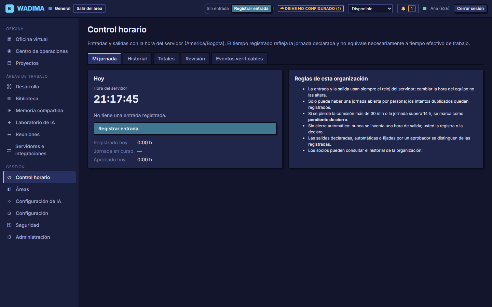
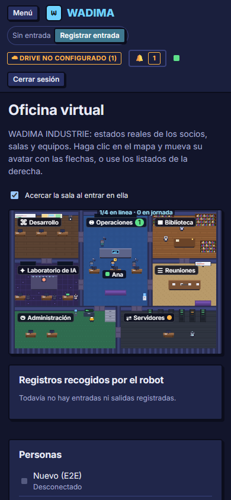
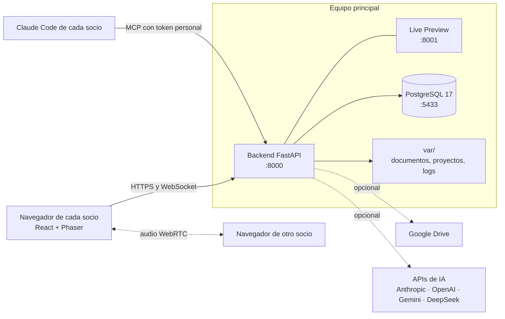

<div align="center">


# WADIMA

**El espacio de trabajo de tu equipo, dentro de una oficina virtual pixel art que corre en tu propio equipo.**

[](https://www.python.org/)
[](https://fastapi.tiangolo.com/)
[](https://www.postgresql.org/)
[](https://react.dev/)
[](https://www.typescriptlang.org/)
[](https://vite.dev/)
[](https://phaser.io/)
[](https://modelcontextprotocol.io/)
[](LICENSE)

[Características](#características) · [Capturas](#capturas) · [Inicio rápido](#inicio-rápido) · [Arquitectura](#arquitectura) · [Documentación](#documentación)

<br>



</div>

---

## ¿Qué es WADIMA?

WADIMA es un espacio de trabajo **local-first** para equipos pequeños. Se instala en un equipo y los demás miembros
entran desde el navegador. Cada persona aparece en una oficina virtual con su estado real. Cada sala abre una
herramienta: proyectos, biblioteca, memoria compartida, reuniones con audio, control horario, un estudio de código
y un laboratorio de IA donde cada socio conecta **su propio Claude**.

Los datos se quedan en tu equipo. Google Drive y la API de Anthropic son opcionales y usan las credenciales de cada
usuario. El nombre de la organización, el logotipo, los colores y la zona horaria se configuran desde la aplicación.

## Características

| | |
|---|---|
| 🏢 **Oficina virtual** | Siete salas en pixel art, avatares con el estado real de cada persona, movimiento con el ratón o las flechas y zoom automático a la sala a la que vas. |
| ⏱️ **Control horario** | Entradas y salidas con la hora del servidor, jornadas incompletas, aprobaciones, totales por día, semana y mes, y exportación a CSV y Excel. Un robot recoge cada registro en la oficina. |
| 🎙️ **Reuniones con audio** | Audio en tiempo real entre socios (WebRTC) con indicador de quién habla. No se graba nada. |
| 🤖 **IA de cada socio** | Cada uno conecta su Claude: su suscripción mediante Claude Code y MCP, o su API key. También puede usar sus propias claves de OpenAI, Google Gemini, DeepSeek o cualquier API compatible con OpenAI (OpenRouter, Groq, Ollama…). Las tareas de un proyecto se asignan a una persona o a la IA de un socio, y cada Claude tiene su avatar en el Laboratorio de IA. |
| 📋 **Proyectos y notas** | Tareas, responsables, comentarios, actividad y edición simultánea con fusión de cambios. |
| 📚 **Biblioteca y memoria** | Sube documentos o carpetas enteras. PDF, Word, Excel y PowerPoint se convierten a Markdown, y el Memory Agent responde citando sus fuentes. |
| 💻 **Project Studio** | Editor, Git, ejecución aislada y Live Preview compartida. Puedes importar tus proyectos desde una carpeta o un ZIP. |
| ☁️ **Google Drive** | Sincronización de documentos y copias de seguridad en tu propio Drive (opcional). |
| 🔐 **Seguridad** | Escucha solo en `127.0.0.1` por defecto, roles de base de datos separados, secretos cifrados, bitácora de auditoría encadenada por hashes y HTTPS con una autoridad local restringida a tu red. |

## Capturas

<table>
  <tr>
    <td width="50%"><br><sub><b>Laboratorio de IA.</b> El Claude de cada socio, con sus tareas en cola o en curso.</sub></td>
    <td width="50%"><br><sub><b>Zoom a la sala.</b> La vista se acerca a la sala a la que va tu avatar.</sub></td>
  </tr>
  <tr>
    <td width="50%"><br><sub><b>Control horario.</b> Jornada con la hora del servidor, historial, totales y revisión.</sub></td>
    <td width="50%" align="center"><br><sub><b>En el móvil.</b> Todos los módulos se adaptan a pantallas pequeñas.</sub></td>
  </tr>
</table>

<sub>Las capturas salen de las pruebas automáticas, con datos de demostración.</sub>

## Inicio rápido

### Requisitos

| Herramienta | Versión probada | Notas |
|---|---|---|
| Windows 11 | 10.0.26300 | No hace falta ser administrador. En Linux y macOS el aislamiento usa rlimits (sin probar) |
| Python + [uv](https://docs.astral.sh/uv/) | 3.12 · uv 0.11 | `uv` crea `backend/.venv` |
| Node.js + pnpm | 24 · pnpm 10 | |
| Git | 2.55 | Lo usa Project Studio |
| PostgreSQL | 17 | Portátil, en el puerto 5433 y solo en `127.0.0.1` |
| Chrome | reciente | Solo para las pruebas de Playwright |

**PostgreSQL portátil, sin instalador ni administrador:** descarga el ZIP «Windows x86-64 binaries» de la versión 17
desde <https://www.enterprisedb.com/download-postgresql-binaries> y extrae la carpeta `pgsql` en
`%USERPROFILE%\.wadima\tools\pgsql` (debe existir `pgsql\bin\pg_ctl.exe`). Para usar otra ubicación, define
`WADIMA_PG_BIN`. Si ya tienes PostgreSQL en el `PATH`, `manage.py` usa ese.

### Instalación

```powershell
git clone https://github.com/jhosMQZ/wadima.git
cd wadima
python manage.py setup   # dependencias, base de datos, credenciales en .env, migraciones y cuentas iniciales
python manage.py dev     # abre http://127.0.0.1:5173
```

`setup` ejecuta `uv sync` y `pnpm install`, crea el clúster de PostgreSQL con dos roles (`wadima` para las
migraciones y `wadima_app` para la aplicación), las bases `wadima`, `wadima_test` y `wadima_e2e`, escribe sus
credenciales en `.env`, aplica las migraciones y crea las tres cuentas iniciales con el área «General».

**Primer acceso:**
- Las contraseñas temporales de `socio1` (administrador), `socio2` y `socio3` se muestran una vez y quedan en
  `var/secrets/initial-passwords.txt`. Cada socio debe cambiar la suya al entrar; hasta entonces la API queda
  bloqueada. Entrégalas por un canal privado y borra el archivo cuando las tres se hayan cambiado.
- El administrador ve un asistente inicial: nombre de la organización, logotipo, zona horaria, usuarios, áreas,
  almacenamiento e IA. Se puede repetir en **Configuración → Identidad de la organización**.

Para actualizar una instalación existente: `python manage.py db backup`, `python manage.py migrate` y reiniciar.

### Comandos

| Comando | Qué hace |
|---|---|
| `python manage.py dev` | PostgreSQL, backend en `:8000` y Vite con recarga en caliente en `:5173` |
| `python manage.py start` | Modo producción local: el backend sirve el frontend compilado en `:8000` |
| `python manage.py db start\|stop\|status` | Controla PostgreSQL |
| `python manage.py db backup` | Copia de la base de datos en `var/backups/` |
| `python manage.py migrate` | Aplica las migraciones de Alembic |
| `python manage.py build` | Compila el frontend en `frontend/dist` |
| `python manage.py tls <ip-o-nombre>` | Certificados HTTPS para la red privada (el micrófono los necesita desde otros equipos) |
| `python manage.py test [--e2e]` | ruff, pytest, ESLint, tsc y Vitest; con `--e2e`, además Playwright |

La vista previa de Project Studio se sirve siempre desde un origen propio (`:8001`) dentro del mismo proceso.

<details>
<summary><b>Comandos de administración del backend</b></summary>

Desde `backend/`: `uv run python -m wadima.cli <comando>`

- `reset-password <usuario>`: nueva contraseña temporal, con cambio obligatorio al entrar.
- `verify-audit`: verifica la cadena de hashes de la bitácora de auditoría.
- `restore-backup <copia.json> [--force]`: restaura una copia lógica de `Drive/WADIMA/Backups` en una base vacía.
- `rebuild-blobs`: descarga desde Drive los originales que falten en `var/blobs` y verifica su SHA-256.

</details>

## Arquitectura



| Capa | Tecnología |
|---|---|
| Backend | Python 3.12, FastAPI, SQLAlchemy 2, Alembic, PostgreSQL 17, SDK oficial de MCP, cola de trabajos persistente |
| Frontend | React 19, TypeScript, Vite, Zustand, React Router, Phaser 3 (oficina), CodeMirror (editor) |
| Tiempo real | WebSocket con latido, WebRTC para el audio de las reuniones |
| Pruebas | pytest contra PostgreSQL real, Vitest y Playwright con dos navegadores |
| Herramientas | uv, pnpm, ruff, ESLint, Prettier |

```
backend/   FastAPI (wadima/), migraciones de Alembic y pruebas de pytest
frontend/  React + TypeScript + Vite; la oficina está en src/office (Phaser); pruebas e2e/ con Playwright
docs/      Arquitectura, integraciones, seguridad, hoja de ruta y auditoría del entorno
manage.py  Tareas reproducibles (solo biblioteca estándar)
var/       Datos de ejecución, fuera de Git: documentos, proyectos de Studio, logs y secretos locales
```

## Uso diario

1. Inicia sesión y pulsa **Registrar entrada**. Se usa la hora del servidor y se muestra para que la verifiques. El
   reloj de la barra superior lleva la jornada y **Registrar salida** la cierra.
2. En la oficina, cada sala abre su módulo con doble clic o con «Abrir módulo». También puedes usar el menú lateral.
3. **Control horario:** historial, totales registrados y aprobados, revisión de jornadas incompletas y exportación.
4. **Reuniones:** «Unirse a la reunión» y después «Activar micrófono».
5. **Configuración de IA:** conecta tu Claude con un token MCP desde Claude Code, o con tu API key. Después, en
   cualquier proyecto, asigna tareas a una persona o a «Claude de …». Su Claude Code las recoge cuando su dueño se
   lo pide y entrega el resultado como comentario de la tarea.
6. **Tus proyectos y documentos:** en **Desarrollo → Nuevo proyecto de código**, importa una carpeta o un ZIP de tu
   equipo; se omiten `node_modules`, `.git` y los compilados, y el tipo de proyecto se detecta solo. En la
   **Biblioteca**, «Elegir carpeta» sube todos los documentos admitidos, etiquetados con el nombre de sus carpetas.

## Acceso de los otros socios

Por defecto todo escucha solo en `127.0.0.1`. **No abras puertos del router.** Los demás socios solo necesitan un
navegador y la dirección privada del equipo principal:

- **Misma red local:** ejecuta `python manage.py tls <ip-privada>`, añade `WADIMA_BIND_HOST=<ip-privada>` a `.env`,
  arranca con `python manage.py start` y entrega a cada socio `var/secrets/tls/ca.crt`. Entran en
  `https://<ip-privada>:8000`.
- **Redes distintas:** usa una VPN privada como Tailscale. Ver [`docs/SECURITY.md`](docs/SECURITY.md#acceso-remoto).

El micrófono de las reuniones exige HTTPS fuera de `localhost`.

## Configuración

`db init` copia `.env.example` a `.env`. Cada variable está explicada en ese archivo y ningún valor real se guarda
en el repositorio. Las API keys de Anthropic no van en `.env`: cada socio la introduce en **Conexiones → Claude** y se
guarda cifrada.

## Pruebas

```powershell
python manage.py test          # ruff, pytest, ESLint, tsc y Vitest
python manage.py test --e2e    # además, compila y ejecuta Playwright
```

- **Backend:** 120 pruebas de pytest contra PostgreSQL real (`wadima_test`). Drive y Anthropic se prueban contra
  servidores simulados.
- **Frontend:** 26 pruebas de Vitest.
- **Extremo a extremo:** 26 pruebas de Playwright con su propio backend en `:8010` y `:8011` sobre `wadima_e2e`, que
  se recrea en cada ejecución con datos de demostración. Las reuniones se prueban con audio entre dos navegadores y
  el servidor MCP con el cliente oficial del SDK.

## Documentación

| Documento | Contenido |
|---|---|
| [`docs/ARCHITECTURE.md`](docs/ARCHITECTURE.md) | Módulos, modelo de datos, tiempo real y despliegue entre socios |
| [`docs/INTEGRATIONS.md`](docs/INTEGRATIONS.md) | Google Drive, Claude (suscripción vía MCP o API key), otras APIs de IA y tareas para la IA |
| [`docs/SECURITY.md`](docs/SECURITY.md) | Modelo de amenazas, aislamiento de Studio, acceso remoto y secretos |
| [`docs/ROADMAP.md`](docs/ROADMAP.md) | Estado por fases, resultados de las pruebas y pendientes |
| [`docs/ENVIRONMENT_AUDIT.md`](docs/ENVIRONMENT_AUDIT.md) | Entorno de referencia y decisiones derivadas |

## Licencia

Copyright © 2026 jhosMQZ.

WADIMA es software libre: puedes usarlo, estudiarlo, modificarlo y redistribuirlo bajo los términos de la
[GNU Affero General Public License v3.0](LICENSE). Si lo modificas y lo ofreces a otras personas, también a través
de la red, debes publicar el código fuente de tu versión con la misma licencia. Se distribuye sin ninguna garantía.

Las dependencias conservan sus propias licencias; por ejemplo, PyMuPDF (conversión de PDF) se distribuye bajo
AGPL-3.0 o licencia comercial de Artifex.
